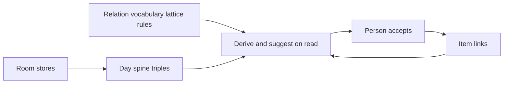

# Applying *Building Knowledge Graphs* to Brain2

_2026-10-28._ Co-time suggestions are already wired. `lib/graph/densify/co-time-rows.ts` is called from `components/ItemDetail/tabs/links/use-links-graph.ts` and the weekly graph review.

Source: Jesús Barrasa and Jim Webber, *Building Knowledge Graphs: A Practitioner’s Guide* (O’Reilly, 2023), [`docs/Building-Knowledge-Graphs-Practitioner's-Guide-OReilly-book.pdf`](docs/Building-Knowledge-Graphs-Practitioner's-Guide-OReilly-book.pdf). Ideas below are paraphrased. The book’s Cypher, LOAD CSV, and Neo4j tooling are not copied in.

This reading sits beside [`docs/KNOWLEDGE_GRAPH_PLAN.md`](docs/KNOWLEDGE_GRAPH_PLAN.md) (Hogan plus this book, 238 `KG-*` proposals, last mapped 2026-10-16) and [`docs/LINKS_REDESIGN.md`](docs/LINKS_REDESIGN.md) (the Links tab, mostly built). It does not reopen refused work. The numbered idea bank stays in that plan. Do not rebuild the 238-id register.

## The fit in one page

The book’s definition (ch. 1): a knowledge graph is interlinked facts plus an **organizing principle**, so a person or a program can reason. Storage may be a graph database, a federation, or a **smart index over data that stays where it is**.

Brain2 already matches that definition at personal scale:

- **Facts.** Items in `brain2-task-storage`. Directed typed edges on `Task.links` (`ItemLink`: `relation`, `targetId`, optional `stance`, `weight`) in [`lib/types.ts`](lib/types.ts). Other facts stay in their stores: time-grid blocks, list membership, task `dependencies`, pen links, phone rows, ingest events.
- **Organizing principle.** [`RelationDef`](lib/links.ts) (inverse, scope, family, parent, traits, reciprocity, phrases, `aliasOf`), the lattice in [`lib/graph/relation-lattice.ts`](lib/graph/relation-lattice.ts), chain rules in [`lib/graph/relation-rules.ts`](lib/graph/relation-rules.ts), checks in [`lib/graph/relation-checks.ts`](lib/graph/relation-checks.ts). Meaning lives in the data, not only in one screen.
- **Reasoning on read.** [`lib/graph/ego-reason.ts`](lib/graph/ego-reason.ts) derives edges with proofs. Nothing is written until a person accepts.
- **Index over a lake.** [`lib/graph/vault-graph.ts`](lib/graph/vault-graph.ts) projects a day spine of triples `{ s, p, o, graph, order, at? }` from several stores. Orders are `observed`, `recorded`, `derived`, `inferred`. That is the book’s virtualized knowledge graph (chs. 1, 5, 14), not a second database.
- **Enrichment with a person in the loop.** Densify suggestions, identity `same-as` proposals, snapshot export, proposal inbox. Accept is the only write. This is stricter than the book’s “enrich the graph” and it should stay stricter.

The book’s enterprise stack (Neo4j, Cypher/GQL, APOC, Kafka, Spark, GraphQL, GDS write-back, OWL reasoners) does not transfer. The **patterns** do: just-enough semantics, idempotent enrich, pattern questions, identity as proposals, dependency impact, strings resolved to things, and a lake that stays a lake.

## Standing refusals (the book does not override these)

From [`docs/LINKS_REDESIGN.md`](docs/LINKS_REDESIGN.md) §16 and the knowledge-graph laws already in force:

- No graph database. The vault stays local JSON. The ego index and the day-spine projection are the query layer.
- No model running inside the app. A model may read a snapshot and return a proposal file. L8.3 (an in-app proposer) stays deferred.
- No link is rewritten in bulk. Relation merge is an alias at read time.
- No auto-written reverse edge, no silent `same-as` merge, no certainty column, no embedding as a reason on the Links tab.
- No `concept` type. Categories are items plus relations.
- Rule chains stay short (1–3) plus declared transitivity. Depth-6 walks stay ego-bounded.

“Could be more” below only proposes work that honors those fences.

---

## Chapter 1 — Introducing knowledge graphs

**Idea.** Nodes, labels, directed typed relationships, properties on both. Schema-ish constraints only where needed. A knowledge graph is facts plus an organizing principle. It can be materialized, federated, or a logical layer over other stores. Smarter data is reused by many rooms; intelligence is not trapped in one screen.

**Already.** Item types are labels. `ItemLink` is a directed typed edge with two properties. Person, Location, Book, Film, and the rest are domain labels. Backlinks are computed, not stored twice. [`lib/link-graph.ts`](lib/link-graph.ts) reads a neighbourhood in both directions. The day spine is the virtual layer. Many rooms already reuse one item (lists, To Do, Scheduler, People, Tracking).

**Not yet.** There is no single place a person can see every edge kind as one graph. Dependencies, list links, pen parents, and item links are separate. The spine covers time, captures, and some people questions; it does not cover the link vocabulary. Node properties are the whole item record, which is richer than a property graph and harder to query as one shape. Relationship properties stop at `stance` and `weight` (on purpose).

**More.** Treat “one item, many rooms” as the product of this chapter, not a new store. The next structural step is KG-D1 as a **read-only projection**: one triple list that includes item links plus the other edge kinds the Links redesign already named, each tagged with its source graph and its order. Screens keep writing to their own stores. Extend [`lib/graph/pattern-questions.ts`](lib/graph/pattern-questions.ts) so a house question can see that projection, not only the day spine.

---

## Chapter 2 — Organizing principles

**Idea.** A plain graph hides meaning in application code. A property graph is a weak contract (labels, types, direction). A **taxonomy** adds broader/narrower so “kind of” works without domain code. An **ontology** adds arbitrary relations, relation hierarchies, and traits (transitive, symmetric, functional). Layer several taxonomies on the same nodes. Use **just-enough semantics**: do not boil the ocean. Prefer a standard (SKOS, Schema.org, Dublin Core) when it fits; otherwise write your own and keep it malleable. RDF is an exchange format, not a storage mandate. A living graph gets richer because people use it.

**Already.** This is the strongest match in the app. The relation lattice is an ontology of relations: `mother-of` ⊑ `parent-of` ⊑ `family-of` ⊑ `knows`, `phase-of` ⊑ `part-of`, traits for transitive, acyclic, functional, inverse-functional, disjoint. Chain rules are small Horn clauses with proofs. Checks enforce scope, functional cardinality, cycles, irreflexivity, and disjoint pairs. Phrases are the lexicalization the book later wants for generation. Item types and subtypes are a shallow taxonomy of **nodes**, separate from the relation lattice. Families (`RelationFamily`) are a colour and sector key, not a logic. The house already refused OWL and a global concept type, which matches “just enough.”

**Not yet.** The taxonomy and lexical packs are on disk and **off** until a person adds them (`lib/graph/seed-packs/taxonomy.ts`, `lexical.ts`). Tags are free strings, not addressable nodes (`tag:` waits on KG-I1). Nothing walks `broader` for similarity yet. Standards are house words, not SKOS IRIs. There is no RDF or JSON-LD export; the snapshot JSON is the exchange format, and that is enough.

**More.** Leave both packs opt-in. Do not turn taxonomy on by default until a person answers the open question in Links redesign §17. Use the lattice before adding Wu–Palmer or Leacock–Chodorow (ch. 13). Do not import SNOMED, FIBO, or Schema.org wholesale. If a later exchange needs it, map a few house relations to SKOS labels in the snapshot, as documentation, not as a second vocabulary the UI must speak.

Use grows the graph only through accepts: the densify shelf, the weekly review, and the inbox. That is the virtuous cycle, with a brake.

---

## Chapter 3 — Graph databases and queries

**Idea.** Cypher is a diagram you can run: local patterns (“Rosa lives in Berlin”) and global patterns (everyone who…). `MERGE` avoids duplicates while enriching. Constraints are applied where a label needs them. Transactions make a write atomic. Introspection describes the shape.

**Already.** Local patterns exist and are the product: ego edges, second ring, path (undirected BFS, depth 6) in [`lib/graph/link-path.ts`](lib/graph/link-path.ts), neighbourhood matrix, “why is this here?” proofs. House questions and `? subject relation object` in [`lib/graph/pattern-questions.ts`](lib/graph/pattern-questions.ts) are a tiny pattern language over spine triples. Constraints are the relation checks plus `fromTypes` / `toTypes`. Duplicate control on enrich is the inbox dedupe and the identity blockers (existing `same-as`, `different-from`, dismissed proposal). Writes go through `commitItemDraft` / `addLink`, one item at a time, which is the personal version of a small transaction. The Relations library is the introspection UI (usage counts, schematic, dry run).

**Not yet.** There is no global pattern match across edge kinds (“who blocks a task that is part of a goal I have not touched this month”). Path finding ignores relation type. `MERGE` semantics do not exist for imports: ingest creates items; it does not upsert links. ACID across stores is not a goal; a backup is a JSON snapshot of localStorage ([`lib/data/backup.ts`](lib/data/backup.ts)).

**More.** Grow the pattern language you have, not a Cypher parser. Concrete shapes worth adding, each a named function with a sentence, in the same style as `peopleDuring` and `peopleNotSeenButMessaged`:

- Neighbours of an item under a relation **or any subrelation** (the lattice already defines ⊑; walks should use it the way the reasoner does).
- Paths that may require a relation family (so “how am I connected, through people only” is not the same as any-edge BFS).
- One cross-store question once KG-D1’s projection exists: open work blocked by a person you have not been with in the period (dependencies ∩ spine).

Keep depth caps. A global scan of a personal vault is cheap; unbounded recursion is the thing the book’s databases also have to limit.

---

## Chapter 4 — Loading data

**Idea.** Separate the first bulk load from later enrichment. Natural keys and idempotent merges stop duplicates. Preview before commit. Bad rows are counted, not fatal to the whole load.

**Already.** Ingest is idempotent for phone rows, sleep blocks, and screen-time blocks (`generatedBy` stamps, re-derive does not touch hand-painted time). [`lib/graph/proposal-schema.ts`](lib/graph/proposal-schema.ts) counts dropped rows. Instagram following/follower files parse in [`lib/instagram-export.ts`](lib/instagram-export.ts) without inventing edges the file does not contain. Backup restore is a full vault load, not a graph load. Identity matching is a second pass over data that is already stored.

**Not yet.** Nothing bulk-proposes `Item.links` from a CSV, a recipe, a book list, or an Instagram export. Captures become items with `captureOrigin`; they do not become edges. The book’s importer UI has no analogue except the proposal file.

**More.** Any new importer emits **proposal rows**, never links. The first honest one is already implied by [`docs/INSTAGRAM_DATA_SOURCES.md`](docs/INSTAGRAM_DATA_SOURCES.md): accounts as person items (match on Instagram handle, which identity-match already looks at), `follows` as proposals with `first_seen` carried in the proposal reason, not as a new `ItemLink` field. A missing edge stays “not loaded.” Kitchen recipes and book metadata should follow the same door when they want edges (`part-of`, `written-by`): resolve names, propose, accept. Do not add LOAD-CSV inside the app.

---

## Chapter 5 — Integrating with other systems

**Idea.** A data fabric lets one question cross systems. Prefer virtualization (leave rows in the source, query through the graph) over copying everything into the graph. Federation, drivers, and ETL are how enterprises do that. GraphQL is one serving shape, not the model.

**Already.** The day spine is virtualization: time grid, completions, scheduled spans, period reviews, and applied ingest events stay in their stores and are read as triples. Phone message bodies stay in `data/phone-sync/messages.jsonl` and are not pulled into localStorage. [`lib/graph/machinery.ts`](lib/graph/machinery.ts) names several derivations (`whereFrom`, `whatReadsThis`): period nesting, list rules, implied actions, belief strength, pen rollups. Health, NFC, and location have their own apply paths and are only lightly joined. Co-time suggestions are wired from painted company time (`lib/graph/densify/co-time-rows.ts`, Links redesign L4.2): the Links graph and the weekly graph review both call it. That join is the book’s “relationship to connect data and metadata.”

**Not yet.** Habit cells, the GPS name file, and Telegram-as-a-message-to-a-person are explicitly **not** on the spine (see the `vault-graph` note in [`lib/README.md`](lib/README.md)). List–list links, task dependencies, and pen “always means” links are not in the projection. There is no composite query API. Cmd-K is the serving layer, not GraphQL, and that is the right serving layer for this app.

**More.** Extend the spine by named gaps, each with an order:

- Dependencies and list links join the read-only projection (ch. 1), still written only in their stores.
- Leave message bodies, health samples, and GPS traces in their files. Project an edge (`texted`, `was-at`, `slept`) with a pointer back, the way phone rows already point at a person through pens.

Do not add Kafka, Spark, or a GraphQL gateway.

---

## Chapter 6 — Graph data science

**Idea.** Algorithms (paths, centrality, community, similarity, link prediction) are run on a **projection**, then useful scores may be written back as properties. Production systems version that projection and do not let an experiment overwrite source truth.

**Already.** The useful small set is shipped and stays explanatory: local clustering and open triads ([`lib/graph/ego-density.ts`](lib/graph/ego-density.ts)), Adamic–Adar triads, co-member with IDF, mention spans, reciprocal gaps. Weekly review reports link edits per week, linkability by type, and mean clustering ([`lib/graph/graph-review.ts`](lib/graph/graph-review.ts)). Suggestions are not written back. That matches the book’s production caution better than a GDS `write` mode.

**Not yet.** No PageRank, betweenness, Louvain/Leiden, node embeddings, or whole-vault community labels. Density over time has no historical snapshots of clustering, only the activity ledger. Centrality would be a number without a sentence, which the Links redesign already refused for embeddings.

**More.** Do not add a graph-algorithm library. Two read-only sentences are enough if a weekly review needs them, computed ephemerally and never stored:

- **Bridge:** a person whose removal increases the number of components in the people subgraph (a plain articulation point, not betweenness).
- **Cluster:** connected components under `knows` and its subrelations, named by the two or three highest-degree members.

If either sentence is not something you would act on in review, do not build it. Link prediction stays the densify shelf.

---

## Chapter 7 — Graph-native machine learning

**Idea.** Topological features feed a pipeline (split, train, predict links or labels). The worked example recommends a complementary actor from co-occurrence. Results are written back only after the pipeline is trusted.

**Already.** The file door is the pipeline: [`lib/graph/graph-snapshot.ts`](lib/graph/graph-snapshot.ts) exports vocabulary, rules, items, and links, and leaves private items and notes out. [`lib/graph/proposal-schema.ts`](lib/graph/proposal-schema.ts) checks closed outputs (known ids, or an explicit new relation proposal). Accepted model rows stay `inferred` until a person edits them. Deterministic suggestors run first. L8.3 is deferred on purpose.

**Not yet.** No training, no holdout eval set in-repo, no in-app model. Complementary-item recommendations that need embeddings are refused on the tab.

**More.** Leave L8.3 deferred. If a model is used, it stays outside and must satisfy the tier already written in Links redesign §11: evidence span, existing ids, cost cap, private subgraph never sent. The book’s “recommending complementary actors” is already the triad and co-member shelf for a personal vault; a model should only propose where those sources cannot see (a note that names an item the string matcher missed). Do not train a link predictor inside the app.

---

## Chapter 8 — Metadata knowledge graphs

**Idea.** In a company, datasets, platforms, pipelines, owners, and sinks are themselves a graph, so stewardship questions (“what breaks if this table changes?”) are traversals.

**Already.** [`lib/graph/machinery.ts`](lib/graph/machinery.ts) is a small metadata graph of **named derivations**, not of every storage key. The activity ledger records who accepted a link and whether it was recorded or inferred. Backup coverage tests know which keys exist. Item types, lists, and pens are metadata a person can open.

**Not yet.** There is no node for “the iPhone Texts store” related to “the person page” and “the day spine.” `machinery` says it is not a store-key manifest. A person cannot ask “what reads Company pens?” as a graph question except where `whatReadsThis` was hand-listed.

**More.** Extend `DERIVED_VALUES` only when a derivation is added, which is current practice. Add a short, hand-written map of the **rooms a person crosses** (phone row → person, painted block → habit minutes, evidence link → belief strength), each pointing at the function that owns it. Do not generate a graph of all `brain2-*` keys. That catalog belongs in [`lib/README.md`](lib/README.md), where it already lives.

---

## Chapter 9 — Identity knowledge graphs

**Idea.** Entity resolution is a pipeline: prepare (normalize, block), match (deterministic rules, then softer scores), persist a master record with survivorship, and only then use unstructured text. Uncertain matches stay reviewable. A missing match is not a merge.

**Already.** [`lib/graph/identity-match.ts`](lib/graph/identity-match.ts) is the deterministic stage: person items, Company pens, who-details, Instagram handles. Matches become inbox proposals (`densify:identity`). A pipeline, an existing `same-as` or `different-from`, or a dismissal blocks the pair. Nothing merges. [`lib/item-merge.ts`](lib/item-merge.ts) is an explicit, destructive merge when a person asks. `same-as` / `different-from` are real relations. Mention densify is the unstructured stage, limited to titles found in notes.

**Not yet.** No blocking index beyond those keys. No survivorship record separate from the item (the book’s “master entity” would be a second object; the house should not add one). Query-time groups of accepted `same-as` links are only partial (KG-I4). Softer scoring (edit distance on names) is not a proposal source. Ingest name resolution ([`lib/ingest`](lib/ingest)) binds commands to habits and lists; it does not bind free text to people.

**More.** Keep the item as the master. After a person accepts `same-as`, **reads** that walk identity (people questions, densify, path) should treat the pair as one node. Writes stay on the item that was opened. That is survivorship without a new table. Add a blocker key only when a real duplicate source exists (phone handle, Telegram id), still as proposals. Do not add probabilistic merge. Unstructured matching stays “title span in a note,” plus the external model’s spanned proposals, never a silent NER pass.

---

## Chapter 10 — Pattern detection

**Idea.** The chapter’s domains are fraud rings and skills graphs. The reusable idea is **motif search**: a small pattern (a ring, a bridge, an innocent bystander, a skill gap) with an explicit semantics, then an operational question (who is affected, what should change).

**Already.** House questions are motifs: people together, a place with one person, captures with no link, people messaged but not seen. Dependency cycles are refused in [`lib/prereqs.ts`](lib/prereqs.ts). Open triads are the “missing edge” motif. Beliefs have evidence links, and [`lib/graph/evidence-watch.ts`](lib/graph/evidence-watch.ts) notices when the observation is not on the spine.

**Not yet.** No skills or expertise graph (habits, goals, and books are the raw material and are not joined that way). No ring/motif language beyond the named functions. Fraud patterns do not belong in this vault.

**More.** Do not build fraud detection. One personal motif is worth it because the data is already there: **a skill as a habit or a goal, evidenced by done work and by books or notes linked to it**, answered as a house question (“what have I practiced that this goal needs?”). Model it with relations you already have (`supports`, `part-of`, `resource-of`) and list membership, not a new skills ontology. Organizational planning in the book (staffing, performance) has no personal analogue worth a feature.

---

## Chapter 11 — Dependency knowledge graphs

**Idea.** Dependencies are edges with semantics: qualified (version, quantity, date), AND versus OR groups, impact (“what fails if this fails”), root cause (walk upstream), single points of failure, and two validations (no cycles; quantities sum).

**Already.** Two dependency systems exist and should stay two, because their meanings differ. Task and step prerequisites ([`lib/prereqs.ts`](lib/prereqs.ts), [`lib/available-tasks.ts`](lib/available-tasks.ts), Scheduler [`components/Scheduler/DependencyGraph.tsx`](components/Scheduler/DependencyGraph.tsx)) are scheduling: cycles refused, unmet deps block availability. Item relation `blocks` is acyclic by trait and lives on the Links tab. [`lib/unlock-value.ts`](lib/unlock-value.ts) is impact in one direction: how much downstream work a task unlocks, with an explanation. `node-needs` already records external waits.

**Not yet.** The Scheduler graph and the Links graph do not read each other. There is no “if this item slips, these goals slip” that crosses `blocks` / `part-of` and task deps. The multidependency algebra in KG-DEP2–DEP5 is the pure module [`lib/graph/dependency-combine.ts`](../lib/graph/dependency-combine.ts). `hasUnmetDependencies` calls it only when the parent has `dependencyCombine`. The impact card is still **planned**. No single-point-of-failure pass. Qualified dependencies (only-after a date, only-if a resource is on hand) are partial in needs and deadlines, not on the edge.

**More.** Build KG-DEP2–DEP5 as specified below, and add one read-only **impact card** whose sentence uses that algebra. Downstream tasks are read from `dependencies` where they already live. Downstream items use `blocks` and transitive `part-of` / `subgoal-of` (the reasoner already closes those). Show the cycle if a proposed link would create one (the composer already asks). Do not merge the two stores. Scheduler edges stay off the Links tab. A single point of failure, if built, is the articulation-point sentence from ch. 6 applied to the prerequisite graph, shown in weekly review, not a new diagram.

### Dependency algebra (KG-DEP2–DEP5)

The book’s “semantics of multidependency” (ch. 11): a parent with several children must say how those children combine, and the quantities must be checkable. Today every open prerequisite blocks, which is one combine mode. The new modes sit on top of that and do not retcon it. The functions are `combineSatisfied`, `combineImpactSentence`, and `shareCheck` in [`lib/graph/dependency-combine.ts`](../lib/graph/dependency-combine.ts).

- **Where it lives.** One attribute on the **parent** item, absent by default. Absent means today’s behaviour: every child must be met before the parent is available. Existing dependencies do not change meaning.
- **Modes.**
  - **Additive.** The parent is the sum of the children. `ItemLink.weight` (already on the type, unused in `lib/`) is that child’s share, for example 40% reading and 60% writing. Shares should sum to the expected total (the book’s second validation). A mismatch is a check sentence, not a silent rescale.
  - **Redundant.** Any one open route is enough. The parent loses nothing while another route is still open.
  - **Threshold.** A count on the parent: “two of these four.” Weights are not the satisfaction rule in this mode.
- **What `weight` is not.** The type comment says `weight` is unused except as a child’s share when the parent’s `dependencyCombine` mode is additive. It is not belief certainty. A certainty column is refused. Stance stays the belief spectrum. A link with no parent mode ignores `weight`.
- **Where edges are read.** Task and step prerequisites stay in [`lib/prereqs.ts`](lib/prereqs.ts) and the Scheduler graph. The algebra reads them there. It does not copy them onto `Task.links` or the Links tab. Item-link composition (`part-of`, `subgoal-of`) can use the same parent attribute when the children are links, still without a new `ItemLink` field.
- **Impact sentence.** Dated, and it names the mode. A redundant goal says it loses nothing while another route is open, and names that route and its date (deadline or period). An additive parent says the share still open. A threshold parent says how many routes remain against the count. The default (no mode) keeps the current unmet-dependency sentence.

---

## Chapter 12 — Semantic search and similarity

**Idea.** Search over text becomes search over things once documents are annotated with entities. Similarity is shared entities, weighted by how specific they are. Cold start uses the organizing principle (taxonomy, type) before behavior exists. Annotations should use the same vocabulary as the graph.

**Already.** Cmd-K finds items by name. Mention densify annotates a note when a title string occurs, and it keeps the span. Co-member uses IDF so a rare shared list counts more than a common tag. Type and list membership are the cold-start signals: a new item can be suggested company from shared lists before it has links. Book and kitchen matching resolve external records to items in their own modules.

**Not yet.** Notes are not stored as entity-linked documents. Similarity of two items is not a query (“items like this”). Search does not walk `broader`. The cold-start story is uneven: food, books, and people each match in their own way.

**More.** “Items like this” on the Links tab, computed only from explanations you already trust: shared neighbours weighted like the triad score, shared rare lists/tags, and (once the taxonomy pack exists) distance in the broader/narrower tree. Show the shared things, not a score alone. Do not embed notes. A note becomes an annotation only when a mention is accepted as a link, or when a proposal names a span. That is the book’s “strings to things” with the house’s accept door.

---

## Chapter 13 — Talking to the knowledge graph

**Idea.** Three directions: language as a **source of facts** (extract triples into the vocabulary, not open information extraction), language as a **query**, and language **generated from** the graph. Generation quality depends on annotating the organizing principle with phrases. Taxonomy similarity (path, Leacock–Chodorow, Wu–Palmer) is a metric over broader/narrower, independent of the domain.

**Already.** Relation `phrases` are the generation lexicon. Derived edges render as sentences with proofs. House questions use templates; a triple pattern that matches nothing returns `NO_TRIPLE` and does not invent a sentence ([`lib/graph/pattern-questions.ts`](lib/graph/pattern-questions.ts)). Unknown relation words on a person read as `knows · {word}` ([`lib/self-relations.ts`](lib/self-relations.ts)) rather than a silent new predicate. The proposal file is the extraction door. The path ruler speaks one sentence from forward or inverse phrases ([`lib/graph/path-sentence.ts`](lib/graph/path-sentence.ts)). The lexical pack exists and stays off until it is added.

**Not yet.** Cmd-K is not a parser from English to patterns, beyond the house-question list and the `? s p o` form. Taxonomy metrics (path similarity, Leacock–Chodorow, Wu–Palmer) are not computed. The book’s WordNet-style global lexicon is the wrong scope.

**More.** Query stays template plus `? s p o`, extended when a new motif earns a name (chs. 3 and 10). Extraction stays the proposal file. Do not turn the word bank into a graph.

---

## Chapter 14 — Knowledge lakes

**Idea.** A conventional deployment copies a curated slice into a graph database and lets the lake go stale. A knowledge lake keeps the bulk store and lays a knowledge graph over it as structure, provenance, and access. The graph is allowed to be incomplete. The future the book points at is graphs as the context layer for models, so generation is grounded in stored facts.

**Already.** This is the architecture to keep. localStorage and the phone JSONL file are the lake. The day spine and `Item.links` are two curated layers, with orders that say how a fact was obtained. Private items are left out of snapshots so a model cannot ground on them. The inbox is how model output re-enters, as proposals a person can refuse.

**Not yet.** The two curated layers do not share a question language (chs. 1 and 3). Some lakes (habits, GPS, Telegram person-messages) have no edge in the index, so questions about them fall through to room-specific code. Grounding for a model is “export a snapshot,” not a live tool inside the app, which is the correct incompleteness.

**More.** Finish the virtual layer (projection + pattern questions + opt-in taxonomy). Do not materialize a warehouse. When a model is invited, it receives the snapshot it already can receive, and its answers must cite triple ids or link ids that exist in that file. A sentence with no citation is not a proposal. That is the book’s last claim — graphs tame invention — implemented as a schema check you already have, plus a required evidence span. The Data tab graph below is how a person sees that incompleteness without a warehouse.

---

## Data tab — a graph of what is missing or uncertain

The book’s tools (Bloom, Linkurious, ch. 2) draw a property graph from its own contract, and the later chapters treat incompleteness as data: a missing edge is not a false one, an uncertain match stays reviewable, a dependency total that does not add up is a failed check. Brain2 already computes those holes in the ego tab, the weekly review, and the day spine. Data → Library → Graph (`components/Analytics/library/GraphGapsView.tsx`) lists them. It does not draw a hole as a stored link.

**Already.** Library lives in Data ([`components/Analytics/chrome/analytics-views.tsx`](components/Analytics/chrome/analytics-views.tsx)): Item Types hosts the Relations library, schematic, rules, and inbox. Gaps exist as sentences elsewhere: open triads and reciprocal gaps ([`lib/graph/densify.ts`](lib/graph/densify.ts)), linkability and checks ([`lib/graph/graph-review.ts`](lib/graph/graph-review.ts), [`lib/graph/relation-checks.ts`](lib/graph/relation-checks.ts)), unlinked captures and people messaged but not seen ([`lib/graph/vault-graph.ts`](lib/graph/vault-graph.ts)), evidence whose observation is off the spine ([`lib/graph/evidence-watch.ts`](lib/graph/evidence-watch.ts)), open identity and link proposals ([`lib/graph/graph-inbox-store.ts`](lib/graph/graph-inbox-store.ts)). Derived edges and `inferred` accepts are already a different order from recorded facts. The Links matrix draws open triads as outlined cells, ego only. The Data charter already says missing stays missing ([`docs/analytics-plan/00-charter.md`](docs/analytics-plan/00-charter.md)).

**Not yet.** The Graph plate is a list, not a canvas of dashed and outlined cords. It does not load the day spine, so evidence-off-spine and identity candidates stay off this view. People, places, and goals charts are still time and counts. The Scheduler dependency picture is not in Data. Combine mode is not drawn on this plate.

**More.** One new Library view, two sizes of the same instrument. It does not replace the Links tab, and it does not draw Scheduler edges onto that tab.

- **Small.** A plate: counts of missing and of uncertain, then a short list of sentences. Each sentence is one hole and names its source (open triad, reciprocal, unlinked capture, evidence off the spine, identity proposal, inferred link not yet edited, additive shares that do not sum, a check). Clicking opens the item.
- **Large.** The same holes on a canvas for one slice the person picks (a type, a list, or the people neighbourhood). Recorded edges are solid. Uncertain edges are dashed: inferred accepts, open proposals, derived edges, unresolved `same-as` candidates. Missing edges are gaps, drawn as the matrix draws an open triad — an outline, not a cord — so absence is not mistaken for a weak fact. Cap the slice. A vault-sized hairball is not the view.
- **Uncertain versus missing.** Missing means no stored fact (no link, no observation on the spine, no accepted identity). Uncertain means a fact or a proposal exists but its order is not recorded: inferred, derived, or still in the inbox. Do not impute. Do not score a hole with an embedding.
- **Algebra on this canvas.** When the slice is tasks or goals, a parent’s combine mode (once KG-DEP2–DEP5 exists) is readable on the parent: additive shares, a redundant route still open, a threshold still short. Those edges are read from `dependencies` in place. They are not copied into `Task.links`.
- **Chrome.** Data plates (`.an-plate`), the house graph rule, hue by relation family. Help text states what a gap means. Empty slice: the frame and one sentence, as the studio already does for thin windows.

---

## What to build, in order

Each step is usable alone. None of them adds a database, a model runtime, or a new link field.

1. **Co-time** (Links redesign L4.2) is already wired. Painted company time is the `co-time` suggestion source (`lib/graph/densify/co-time-rows.ts`). Smallest join of tracking and the graph.
2. **Opt-in taxonomy and lexical seed packs** (Links redesign §12) landed 2026-10-28. Off until added from the Relations library. Archive keeps the ids and does not rewrite links.
3. **Read-only vault projection** (KG-D1). [`lib/graph/vault-edges.ts`](../lib/graph/vault-edges.ts) projects item links, `depends-on`, and list links as recorded triples. Pen structure edges and pattern questions over that projection are still open. No new writes.
4. **Pattern questions over that projection.** Subrelation-aware neighbours, family-restricted paths, and one cross-store question (blocked work ∩ people not seen).
5. **`same-as` at read time.** Accepted identity pairs collapse in walks and suggestions; stores stay unmerged.
6. **Dependency algebra (KG-DEP2–DEP5).** The pure layer is in [`lib/graph/dependency-combine.ts`](../lib/graph/dependency-combine.ts). Parent combine mode: additive, redundant, or threshold. Default absent, so current prerequisites stay “all must be met.” `weight` is the child’s share under additive only. Impact is a dated sentence from `combineImpactSentence`. Scheduler edges stay where they are. The impact card that shows that sentence is still planned.
7. **Impact card.** Downstream via task deps and via `blocks` / transitive composition, using that algebra, with the existing proof style.
8. **Data tab graph.** Small plate and large slice. Missing drawn as gaps, uncertain drawn dashed, neither stored as a new edge.
9. **Path sentences.** The path ruler speaks phrases. “Items like this” lists shared neighbours and rare shared lists.
10. **Importers as proposals.** Instagram follows first; other catalogs use the same door.

Explicitly not in this order: PageRank, communities as stored labels, embeddings, OWL, RDF storage, Cypher, GraphQL, a skills ontology, a concept type, in-app ML, auto-merge, a certainty reading of `weight`.

## How this differs from the existing plan

[`docs/KNOWLEDGE_GRAPH_PLAN.md`](docs/KNOWLEDGE_GRAPH_PLAN.md) remains the proposal register. This document is the book’s chapter argument applied to the code as it stands after the 2026-10-27 landings (day spine, identity proposals, machinery, house questions). Where the two disagree, the refusals in Links redesign §16 win. New work should cite a chapter here and a `KG-*` id there, and should not invent a third backlog.
