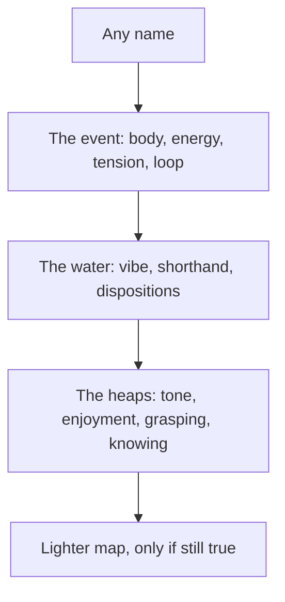

# Mood readings

The name is any word. Great, Good, Meh, and Low stay in the vault as starter pens, equal to any name the person has added. They are not a menu. Typing a new word finds that pen or creates one, with a stable color.

The report on the stretch is split into the three accounts, not into one blended “how do you feel.” Fields that are the same event are asked once and labeled as both (the body is the territory and form; the name is the map and the recognition). Marks are optional integers 1–10, clamped like completion reflections. A blank is left out, never stored as zero. The wellbeing logger stays a separate snapshot.

Prompts below are the house’s words. They are not set in quotation marks and not attributed to anyone.

## The card

In [`components/Home/Tracking/entry-dialog.tsx`](components/Home/Tracking/entry-dialog.tsx), a Mood block shows **This stretch**. Activity blocks do not. Every field can stay empty. Three parts, all visible, compact.

### 1. The event

Kicker: A mood here is the whole organism answering. The silent body comes first. The word is a map laid on it. A hard word can feed the body and keep the hour going.

- **Body.** “The territory, under every name. Heat, weight, breath, pulse, hunger, the chest, the jaw. Write the body. This layer has no opinion.”
- **Energy** (1–10). “How lit the nervous system is — the current, not the story about the current. A low reading is exhaustion or quiet. It is not hopelessness until a word says so.”
- **Tension** (1–10). “How braced the body is. Grip is an event in muscle. It is not yet a mood.”
- **Loop** (1–10). “Once a word is on it: how much does that word tighten or exhaust the body further? A high mark means the label has joined the territory. Seeing that is already a break in the loop.”

### 2. The water

Kicker: There is no inner dial. What meets you is a story told about the hour’s settings, and the leanings those settings leave ready. This is the water the rest of the day swims in.

- **Vibe.** “A phrase for the climate of the hour, not a verdict on a life. ‘Slightly uphill.’ ‘Thin light.’ ‘Everything at a distance.’”
- **Shorthand.** “The sentence the mind is offering, usually too large: ‘I am in a bad mood,’ ‘nothing works.’ Write it as the story. It was composed after the body. It can be revised.”
- **Sociability** (1–10). “Inclination toward other people, as a setting of this hour. Low is not a character.”
- **Initiative** (1–10). “Readiness to begin or to move toward something. The hour raises or lowers the threshold. The threshold is not you.”
- **Cast** (1–10). “How readily attention selects the downcast cue — threat, loss, the old hurt. This is a bias of the hour. Naming it lets the next cue be a cue, not the world.”

**Lighter map.** When the shorthand is an identity (“I am …”) or a forever (“always,” “never,” “everything,” “nothing”), [`lib/mood-reading.ts`](lib/mood-reading.ts) offers one sentence that is still true and a degree lighter: the body as written, the word in quotes, the date, and the story named as a story. Example: `I am hopeless` with a tight chest becomes `This stretch: a tight chest, the word "hopeless," and a story that it covers everything.` The line under the offer: “A lighter map, still true. Use it only if it is more accurate. A kinder sentence that lies is a worse map.” Accept stores it; otherwise the shorthand stays. No offer when the shorthand is already about this stretch. Enjoyment is never nudged upward.

### 3. The heaps

Kicker: Not one object. A body, a tone, a recognition, a leaning, and the knowing of those. Each is conditioned. None of them is an owner.

- **Tone.** Pleasant, unpleasant, or neither. “Feeling-tone, before the story. The tone is not the enemy. What hurts is grasping it or refusing it.”
- **Enjoyment** (1–10). “How much pleasure is actually in the contact. If the tone is unpleasant, a low mark is exact. Do not raise it to look well.”
- **Name.** The free word, chips of existing pens underneath, a new word creating a pen. “The recognition. Any word, including one never stored here. It matches this stretch to a memory, and the match is not the event. This hour is not the other hours this word has named, and the word is not you.” Identity text offers the bare word, as in the lighter map.
- **Grasping** (1–10). “The leaning: clinging to what is pleasant, pushing off what is unpleasant, or spinning a story about either. Often the leaning outweighs the tone. A lower mark is not achieved by force. Force is more leaning.”
- **About that.** “What the mind is doing with the state — keeping it, refusing it, explaining it, becoming it. If a lighter doing is honestly available — a little room, a little kindness toward the hour — you may write that beside it. Do not write a kindness you do not feel.”
- **Knowing** (1–10). “How clearly this is known as a passing process rather than as who you are. A high mark is not a performance. It is only that the heaps are being seen as heaps.”

Close, under the live sentence: “None of this has to be carried past the stretch. The record is a map. etc.”

The sentence is derived, not written into Notes. It quotes the name, dates the stretch, includes only the marks that were set, and ends with etc. whenever anything was filled.

## Data

On [`TimeEntry`](lib/time-entries.ts), mood scope only:

- `word` — spelling on that stretch, so a later pen rename does not rewrite it. The pen is still what the grid paints.
- `sensation`, `vibe`, `narrative`, `reframe`, `about`
- `tone`: `pleasant` | `unpleasant` | `neutral`
- ranks: `energy`, `tension`, `loop`, `sociability`, `initiative`, `cast`, `enjoyment`, `grasping`, `knowing`

Wire the object through `DETAIL_KEYS`, paint, and split. Different readings do not merge. Omit it when empty.

Helpers in [`lib/mood-reading.ts`](lib/mood-reading.ts): `moodSentence`, `normalizeWord`, `identityRewrite`, `lighterMap` (only for identity or forever language), `moodPenColor`, `clampMoodRank`.

BIM `mood:` / `feeling:` already accepts any word and may create a pen. It does not fill this card.

## Read

[`components/Analytics/MoodFieldView.tsx`](components/Analytics/MoodFieldView.tsx) keeps the pen mosaic for whatever names exist, and stops speaking as if four names were the scale.

- **Same word.** Dated rows for one normalized name: clock, quoted word, body, tone, marks set, vibe. Two or more: “These share a word. They are not the same stretch.”
- **The water.** Distinct vibe phrases in the range, each with its dates. Mean cast, sociability, and initiative, with `n`.
- **Marks.** Means for energy, tension, loop, enjoyment, grasping, knowing. Tone counts (pleasant / unpleasant / neither), missing tones left out. Mean grasping where **About that** was written, versus where it was not, when both `n` allow.

Home tracking line shows the current mood name in quotes. Find searches word, body, vibe, shorthand, reframe, and about-that.

## On the screen

Field prompts stay on each control. Above them, the card carries a visible guide, **Using a stretch**, not a hover-only `?`. It is the way through the whole card. Mood field carries a matching **How to read this** under its title, using [`CanvasTitle`](components/Analytics/studio-kit.tsx) / `StudioHelp` for the plate-level lines and a short visible paragraph for the path. Copy:

**Using a stretch**

A color alone is a true record. The full record is the three parts, in this order.

1. Name the stretch with any word. Great, Good, Meh, and Low are pens you may use or ignore. A new word becomes its own color.
2. Write the body before you trust the word. Energy and tension describe the nervous system. Loop is how much the word then tightens the body.
3. Mark only what you can feel. A blank is not a zero, and the marks are not a grade.
4. Write the vibe — the climate the next hours swim in — and the shorthand the mind is offering. If a lighter map appears, take it only when it is more accurate. Do not invent a pleasanter body.
5. Set the tone, the enjoyment that is actually there, the leaning (grasping), and how clearly the heaps are seen. In About that, a kindness counts only if you feel it.
6. Save. Later, Analytics → Time → Mood field keeps the same word on different hours apart, lists the water, and averages only the marks you set.

Close the guide with: This is a practice of description, not a treatment. A long heavy stretch is a record to take to a person, not a verdict the card can fix.

**How to read this** (Mood field)

These plates read the stretches you opened and filled. A painted name with no card is still a color, and it stays out of the averages.

- Same word: one label, many dates. They are not one mood.
- The water: the vibe phrases and the leanings (cast, sociability, initiative).
- Marks: means and counts, each with n. Missing marks are left out.

Open a block from Tracking to add what a color cannot hold.

## Docs and tests

Update every doc this makes stale, in the same pass as the behavior. Rewrite the mood sentences; do not leave “four moods” or “Great, Good, Meh, Low” as the scale.

- [`components/Home/Tracking/README.md`](components/Home/Tracking/README.md) — the card, the three parts, the guide, any-name pens, practice-not-treatment.
- [`components/Home/README.md`](components/Home/README.md) — the tracking tile shows the current mood name in quotes.
- [`components/Analytics/README.md`](components/Analytics/README.md) — Mood field plates and How to read this.
- [`lib/README.md`](lib/README.md) — `mood-reading.ts` and the `moodReading` fields on an entry.
- [`README.md`](README.md) — the Mood view takes any pen name; the block editor holds the three-part reading.
- [`docs/time-context-vision.md`](docs/time-context-vision.md) — the mood row and the Energy and mood section.
- [`docs/SPEC_MAPPING.md`](docs/SPEC_MAPPING.md) — Mood field is painted names plus the reading, not only the four pens and wellbeing metrics.
- [`docs/BIM_COMMANDS.md`](docs/BIM_COMMANDS.md) — `mood:` / `feeling:` still paint any word; the full report is the Tracking card, which a message does not fill.
- [`docs/README.md`](docs/README.md) — only if the time-context blurb still says the mood pictures are unshipped in a way this contradicts.
- [`docs/BRAIN2_FEATURE_IDEAS.md`](docs/BRAIN2_FEATURE_IDEAS.md) idea **392** — partial: any label may paint the wash; the three-part reading is the report.
- [`docs/screenshots/07-analytics-mood-field.txt`](docs/screenshots/07-analytics-mood-field.txt) — rewrite the view-specific note. Recapture `07-analytics-mood-field.png` with `npm run capture-screenshots` when the app is running; if it is not, say so and leave the png.
- [`docs/tree.md`](docs/tree.md) and `docs/tree.txt` via `npm run tree` when `lib/mood-reading.ts` is added.
- [`docs/jungideas.md`](docs/jungideas.md) — only the sentence that treats Mood pens as a closed measure of affect, if that sentence is now false.

Tests: sentence, identity and forever detection, lighter map refused for an already-dated shorthand, rank clamp, new name creates a pen, merge, dialog hidden on activity, same-word grouping, and that the guide text is on the mood card.

Out of this slice: clinical cetasika lists, inventing a pleasant body the person did not report, writing these marks into the wellbeing store, BIM syntax for the card, reserves, and a metta timer.
